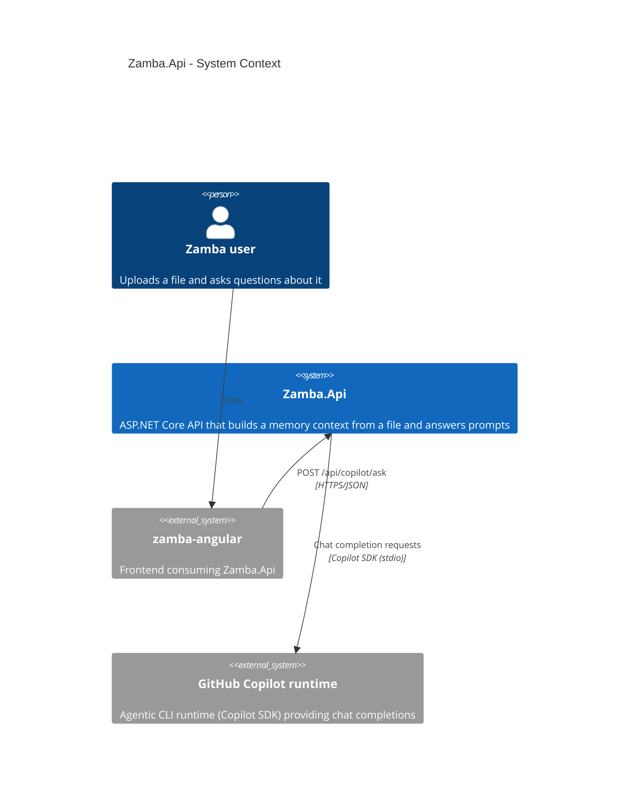
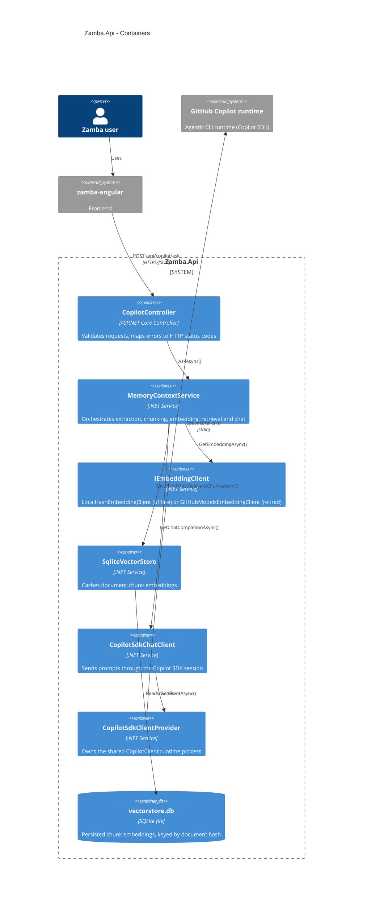
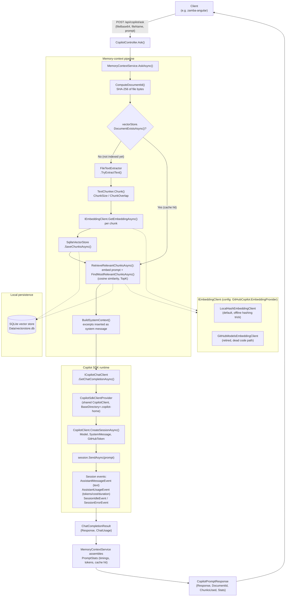

# `/api/copilot/ask` Flow

End-to-end flow of the memory-context pipeline: an uploaded file is chunked, embedded, cached,
and used to ground a prompt sent through the GitHub Copilot SDK.

## C4 - Context

## C4 - Container

## Request flow

## Key components

| Component | Role |
|---|---|
| `Controllers/CopilotController.cs` | HTTP entry point, validates request, maps errors to 400/502 |
| `Services/MemoryContextService.cs` | Orchestrates hashing → extraction → chunking → embedding → retrieval → chat, and times each phase |
| `Services/FileTextExtractor.cs` | Extracts raw text from the uploaded file (e.g. PDF) |
| `Services/TextChunker.cs` | Splits text into overlapping chunks (`VectorStoreOptions`) |
| `Services/LocalHashEmbeddingClient.cs` | Default offline embedding (hashing trick), since GitHub Models is retired |
| `Services/GitHubModelsEmbeddingClient.cs` | Legacy hosted embedding client (only used if `EmbeddingProvider: GitHubModels`) |
| `Services/SqliteVectorStore.cs` | Persists/looks up chunk embeddings per document hash, caches across requests |
| `Services/CopilotSdkClientProvider.cs` | Lazily starts/shares one `CopilotClient` runtime process for the app's lifetime |
| `Services/GitHubModelsChatClient.cs` (`CopilotSdkChatClient`) | Creates a session per request, sends the prompt, collects the assistant's answer + usage stats |
| `Models/PromptStats.cs` / `Models/ChatUsage.cs` | Carry timing, token, cache-hit, and cost diagnostics back in the response |
