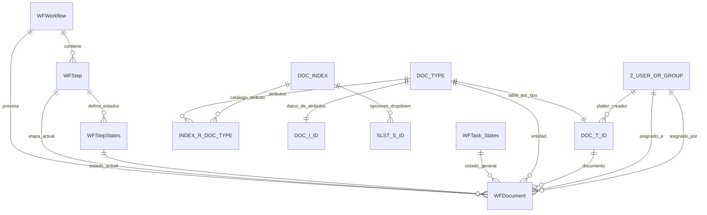

# Esquema de workflow para el dashboard

## Alcance y fuente

Este documento describe las tablas que participan en el monitoreo y las relaciones con las entidades documentales. El inventario completo de tablas y columnas del snapshot disponible está en [DATABASE.md](DATABASE.md). Los conteos indicados allí son los del snapshot documentado, no una lectura en vivo de esta sesión: la conexión TCP al SQL Server configurado se interrumpió desde el entorno de desarrollo. La implementación descubre los nombres de tablas y columnas desde `INFORMATION_SCHEMA` en cada solicitud y no fija los IDs de tipos o atributos.

Los nombres de columnas respetan la grafía del esquema. Las relaciones que se describen como lógicas pueden no tener una restricción FK declarada en SQL Server.

## Tablas de tareas y workflow

### `dbo.WFDocument`

Fila de trabajo/tarea del workflow y documento asociado. El snapshot del inventario registra 1.088 filas.

| Columna | Tipo | Nulo | Uso |
|---|---|---:|---|
| `Doc_ID` | `numeric(18,0)` | No | Documento al que corresponde la tarea. |
| `DOC_TYPE_ID` | `numeric(18,0)` | No | Tipo/entidad documental. |
| `Folder_ID` | `numeric(18,0)` | No | Carpeta asociada. |
| `step_Id` | `numeric(18,0)` | No | Etapa actual. |
| `Do_State_ID` | `numeric(18,0)` | No | Estado actual dentro de la etapa. |
| `Name` | `varchar(250)` | No | Nombre visible de la tarea/documento. |
| `IconId` | `numeric(18,0)` | No | Icono asociado. |
| `CheckIn` | `datetime` | No | Fecha de ingreso/check-in. |
| `User_Asigned` | `numeric(18,0)` | Sí | Usuario o grupo asignado. |
| `Exclusive` | `numeric(18,0)` | Sí | Indicador/valor de exclusividad. |
| `ExpireDate` | `datetime` | No | Fecha límite; se usa para contar tareas vencidas. |
| `User_Asigned_By` | `numeric(18,0)` | Sí | Usuario/grupo que efectuó la asignación. |
| `Date_Asigned_By` | `datetime` | Sí | Fecha de asignación; se usa como fecha de creación de la tarea cuando no hay otra fecha de alta. |
| `Task_ID` | `numeric(18,0)` | No | Identificador de la tarea (PK en el snapshot). |
| `Task_State_ID` | `numeric(18,0)` | Sí | Estado general de la tarea. |
| `Remark` | `numeric(18,0)` | Sí | Marca/observación numérica heredada. |
| `Tag` | `nvarchar(250)` | Sí | Etiqueta adicional. |
| `work_id` | `numeric(18,0)` | No | Workflow al que pertenece. |
| `LastUpdateDate` | `datetime` | Sí | Última modificación registrada. |
| `Comments` | `varchar(1000)` | Sí | Comentarios de la tarea. |

### `dbo.WFWorkflow`

Catálogo de workflows. El snapshot registra 38 filas.

| Columna | Tipo | Nulo | Uso |
|---|---|---:|---|
| `work_id` | `numeric(10,0)` | No | Identificador del workflow (PK). |
| `Wstat_id` | `numeric(10,0)` | No | Estado/configuración del workflow. |
| `Name` | `varchar(50)` | No | Nombre. |
| `Description` | `varchar(100)` | No | Descripción breve. |
| `Help` | `varchar(200)` | No | Ayuda. |
| `CreateDate` | `datetime` | No | Alta del workflow. |
| `EditDate` | `datetime` | No | Última edición del workflow. |
| `Refreshrate` | `numeric(10,0)` | No | Frecuencia de actualización configurada. |
| `InitialStepId` | `numeric(18,0)` | No | Etapa inicial. |

### `dbo.WFStep`

Catálogo de etapas. El snapshot registra 118 filas.

| Columna | Tipo | Nulo | Uso |
|---|---|---:|---|
| `step_Id` | `numeric(18,0)` | No | Identificador de etapa (PK). |
| `work_id` | `numeric(10,0)` | No | Workflow dueño de la etapa. |
| `Name` | `varchar(50)` | No | Nombre visible. |
| `Description` | `varchar(100)` | Sí | Descripción breve. |
| `Help` | `varchar(2000)` | Sí | Ayuda extendida. |
| `CreateDate` | `datetime` | No | Fecha de alta. |
| `ImageIndex` | `numeric(10,0)` | No | Índice de imagen. |
| `EditDate` | `datetime` | No | Última edición. |
| `LocationX` | `decimal(10,0)` | No | Coordenada horizontal de diseño. |
| `LocationY` | `decimal(10,0)` | No | Coordenada vertical de diseño. |
| `max_Hours` | `numeric(10,0)` | No | Límite de horas configurado. |
| `max_docs` | `numeric(10,0)` | No | Límite de documentos configurado. |
| `StartAtOpenDoc` | `numeric(18,0)` | No | Configuración de inicio al abrir documento. |
| `Color` | `varchar(50)` | No | Color configurado. |
| `Width` | `numeric(18,0)` | No | Ancho de la etapa en el diseñador. |
| `Height` | `numeric(18,0)` | No | Alto de la etapa en el diseñador. |
| `Width2` | `numeric(18,0)` | Sí | Ancho secundario. |
| `Orden` | `numeric(18,0)` | Sí | Orden visual/funcional. |

### `dbo.WFStepStates`

Estados válidos por etapa. El snapshot registra 230 filas.

| Columna | Tipo | Nulo | Uso |
|---|---|---:|---|
| `Doc_State_ID` | `numeric(18,0)` | No | Identificador del estado (PK). |
| `Description` | `nvarchar(250)` | Sí | Descripción. |
| `Step_Id` | `numeric(18,0)` | No | Etapa a la que pertenece. |
| `Name` | `varchar(50)` | No | Nombre visible del estado. |
| `Initial` | `numeric(18,0)` | No | Indicador de estado inicial. |

### `dbo.WFTask_States`

Catálogo de estados generales de tarea. El snapshot registra 7 filas.

| Columna | Tipo | Nulo | Uso |
|---|---|---:|---|
| `Task_State_Id` | `numeric(18,0)` | No | Identificador (PK). |
| `Task_State_Name` | `nvarchar(30)` | No | Nombre del estado general. |

## Catálogo de entidades y atributos

### `dbo.DOC_TYPE`

Catálogo de entidades/tipos documentales. El snapshot registra 42 filas.

| Columna | Tipo | Nulo | Uso |
|---|---|---:|---|
| `DOC_TYPE_ID` | `numeric(18,0)` | No | ID que determina el sufijo de las tablas físicas de entidad. |
| `DOC_TYPE_NAME` | `char(60)` | Sí | Nombre de la entidad. |
| `FILE_FORMAT_ID` | `numeric(18,0)` | Sí | Formato de archivo. |
| `DISK_GROUP_ID` | `numeric(18,0)` | Sí | Grupo de almacenamiento. |
| `THUMBNAILS` | `numeric(18,0)` | Sí | Configuración de miniaturas. |
| `ICON_ID` | `numeric(18,0)` | Sí | Icono. |
| `CROSS_REFERENCE` | `bit` | Sí | Configuración de referencias cruzadas. |
| `LIFE_CYCLE` | `bit` | Sí | Indicador de ciclo de vida. |
| `OBJECT_TYPE_ID` | `numeric(4,0)` | Sí | Tipo de objeto. |
| `AUTONAME` | `nvarchar(255)` | Sí | Regla de nombre automático. |
| `DOCCOUNT` | `numeric(18,0)` | Sí | Conteo documental configurado. |
| `DocumentalId` | `numeric(18,0)` | Sí | Identificador documental adicional. |
| `MB` | `decimal(18,0)` | Sí | Tamaño asociado. |

### `dbo.DOC_INDEX`

Catálogo global de atributos/índices. El snapshot registra 233 filas.

| Columna | Tipo | Nulo | Uso |
|---|---|---:|---|
| `INDEX_ID` | `numeric(18,0)` | No | ID de atributo. |
| `INDEX_NAME` | `char(100)` | No | Nombre visible del atributo. |
| `INDEX_TYPE` | `char(10)` | Sí | Tipo de dato/configuración del atributo. |
| `INDEX_LEN` | `numeric(10,0)` | Sí | Longitud. |
| `AUTOFILL` | `numeric(18,0)` | Sí | Configuración de autocompletado. |
| `NOINDEX` | `numeric(18,0)` | Sí | Configuración de indexación/búsqueda. |
| `DROPDOWN` | `numeric(10,0)` | Sí | Indicador de atributo con lista. |
| `AUTODISPLAY` | `numeric(18,0)` | Sí | Configuración de visualización automática. |
| `INVISIBLE` | `numeric(18,0)` | Sí | Indicador de ocultamiento. |
| `OBJECT_TYPE_ID` | `numeric(10,0)` | Sí | Tipo de objeto asociado. |
| `DROPDOWNTYPE` | `numeric(18,0)` | Sí | Tipo de lista desplegable. |
| `ALLOWDATAOUTOFLIST` | `numeric(18,0)` | Sí | Permite valores fuera de la lista. |

### `dbo.INDEX_R_DOC_TYPE`

Relación muchos-a-muchos entre entidad y atributo; determina los campos disponibles para cada tipo documental. El snapshot registra 638 filas.

| Columna | Tipo | Nulo | Uso |
|---|---|---:|---|
| `INDEX_ID` | `numeric(18,0)` | No | Atributo. |
| `DOC_TYPE_ID` | `numeric(18,0)` | No | Entidad que expone el atributo. |
| `ORDEN` | `numeric(18,0)` | No | Orden del campo en la entidad. |
| `MUSTCOMPLETE` | `numeric(18,0)` | Sí | Campo obligatorio. |
| `LoadLotus` | `numeric(18,0)` | Sí | Configuración de carga. |
| `ShowLotus` | `numeric(18,0)` | Sí | Configuración de visualización. |
| `Complete` | `numeric(18,0)` | Sí | Estado/configuración de completitud. |
| `IndexSearch` | `char(20)` | Sí | Configuración de búsqueda. |
| `DefaultValue` | `varchar(100)` | Sí | Valor por defecto. |
| `IsDataUnique` | `decimal(5,0)` | Sí | Indicador de unicidad. |
| `ISREFERENCED` | `numeric(18,0)` | Sí | Indicador de referencia. |
| `Autocomplete` | `numeric(18,0)` | Sí | Configuración de autocompletado. |
| `MinValue` | `varchar(100)` | Sí | Límite inferior. |
| `MaxValue` | `varchar(100)` | Sí | Límite superior. |

## Tablas físicas por entidad

Los nombres siguientes son patrones, no tablas que deban codificarse individualmente:

- `dbo.DOC_T{DOC_TYPE_ID}` almacena la fila/archivo documental. El snapshot disponible contiene `DOC_T156129` con columnas `DOC_ID numeric(18,0)` (PK), `FOLDER_ID numeric(18,0)`, `DISK_GROUP_ID int`, `PLATTER_ID int`, `VOL_ID int`, `DOC_FILE nchar(200)`, `OFFSET int`, `DOC_TYPE_ID int`, `NAME nvarchar(255)`, `ICON_ID int`, `SHARED int`, `Original_filename nvarchar(255)`, `ver_Parent_id numeric(18,0)`, `version int`, `RootId numeric(18,0)`, `NumeroVersion int` y `FileSize decimal(18,0)`. `PLATTER_ID` identifica el creador según el modelo indicado para Zamba.
- `dbo.DOC_I{DOC_TYPE_ID}` almacena los valores de atributos de una entidad. El conjunto de columnas varía con el tipo y la base; el dashboard consulta `INFORMATION_SCHEMA` y admite almacenamiento en columnas cuyo nombre corresponde al `INDEX_ID` (o variantes identificables) y filas atributo/valor cuando el esquema expone ID de índice y valor. No se presume una lista estática de columnas.
- `dbo.SLST_S{INDEX_ID}` almacena las opciones del atributo con lista. En el ejemplo del snapshot, `SLST_S156664` tiene `Codigo varchar(200)` (PK) y `Descripcion varchar(60)`. El backend busca estas columnas por catálogo para traducir el código a su etiqueta.

La tabla `z_user_or_group` provee IDs y nombres de usuarios/grupos según el modelo funcional de Zamba. El inventario snapshot de [DATABASE.md](DATABASE.md) no contiene una tabla con ese nombre; por eso la API la trata como catálogo opcional y descubre columnas de ID/nombre. `WFDocument.User_Asigned` es la asignación actual; `WFDocument.User_Asigned_By` identifica quién asignó; `DOC_T{DOC_TYPE_ID}.PLATTER_ID` identifica al creador.

## Relaciones lógicas

| Origen | Destino | Significado |
|---|---|---|
| `WFDocument.work_id` | `WFWorkflow.work_id` | Workflow actual de la tarea. |
| `WFDocument.step_Id` | `WFStep.step_Id` | Etapa actual. `WFStep.work_id` acota sus etapas al workflow. |
| `WFDocument.Do_State_ID` | `WFStepStates.Doc_State_ID` | Estado actual de la etapa; `WFStepStates.Step_Id` indica a cuál pertenece. |
| `WFDocument.Task_State_ID` | `WFTask_States.Task_State_Id` | Estado general de la tarea. |
| `WFDocument.DOC_TYPE_ID` | `DOC_TYPE.DOC_TYPE_ID` | Entidad asociada. |
| `DOC_TYPE_ID` | sufijo de `DOC_T{DOC_TYPE_ID}` / `DOC_I{DOC_TYPE_ID}` | Selección dinámica de tabla documental y de atributos. |
| `DOC_T{DOC_TYPE_ID}.DOC_ID` | `WFDocument.Doc_ID` | Documento asociado a la tarea. |
| `DOC_T{DOC_TYPE_ID}.PLATTER_ID` | `z_user_or_group` ID | Creador del documento/tarea. |
| `WFDocument.User_Asigned` | `z_user_or_group` ID | Usuario o grupo asignado. |
| `WFDocument.User_Asigned_By` | `z_user_or_group` ID | Usuario/grupo que asignó. |
| `INDEX_R_DOC_TYPE.DOC_TYPE_ID` | `DOC_TYPE.DOC_TYPE_ID` | Atributos disponibles por entidad. |
| `INDEX_R_DOC_TYPE.INDEX_ID` | `DOC_INDEX.INDEX_ID` | Nombre y configuración del atributo. |
| `DOC_I{DOC_TYPE_ID}` | `DOC_ID` + atributo | Valores almacenados para el documento. |
| `SLST_S{INDEX_ID}.Codigo` | valor del atributo | Código que se resuelve como `Descripcion`. |

## Diagrama

`DOC_T_ID`, `DOC_I_ID` y `SLST_S_ID` representan familias dinámicas de tablas, no nombres literales ni tablas fijas.

## Consulta del dashboard

- La API obtiene tablas y columnas de `INFORMATION_SCHEMA.COLUMNS` y usa los valores del catálogo para formar nombres dinámicos; los valores de filtros siempre son parámetros SQL.
- `GET /api/workflow-dashboard/filters` expone workflows, etapas, entidades, estados y principals detectados.
- `GET /api/workflow-dashboard/tasks` filtra por workflow, etapa, entidad, asignado, fecha de check-in o fecha de asignación, y pagina hasta 100 filas por solicitud. Devuelve contadores de tareas, vencidas y sin asignar.
- `GET /api/workflow-dashboard/tasks/{taskId}/detail` carga atributos asociados a la entidad y traduce listas `SLST_S{INDEX_ID}` cuando existen.
- Los IDs `numeric(18,0)` se serializan como texto para no perder precisión al pasar por JavaScript.
